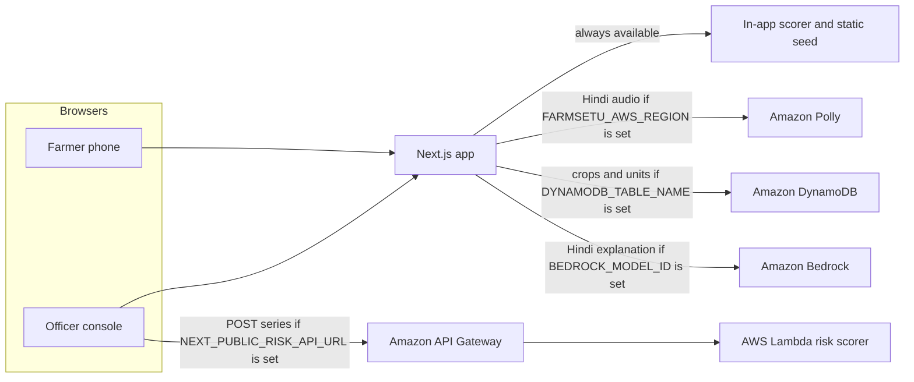

# Kisan Setu

Crop surplus becomes food waste when a glut hits the mandi and nobody routes it. Kisan Setu scores crash risk from three public signals, matches the extra tonnes to nearby SHG and FPO processing units, and calls the farmer in Hindi.

Built for the WeMakeDevs AWS Environmental Hacks track on waste. The same app is the SIH 2026 Glut to Value demo.


## Problem

A harvest flood drops the spot price. Farmers dump crop they cannot sell. Processing units nearby still have weekly capacity, and they sell paste, flakes, or pickle that keeps. The missing piece is a fast wire: which crop, which unit, which farmer, this week.

## Solution

1. Score crash risk from 0 to 100. Arrivals surge 45%, price slide 40%, harvest month 15%. This is a danger meter, not a price forecast.
2. Match surplus to units by distance and weekly capacity. The offer is the crash price plus a small bonus, floored at ₹9/kg.
3. Speak the offer. Hindi can go through Amazon Polly. Kannada and English stay on the browser voice.

Waste numbers on the landing page and the officer console are computed from this demo's Kolar series and the unit list. They are labeled that way. They are not a national estimate.

## Architecture



If an env var is missing, or the AWS call fails, that feature falls back. The demo still runs with no credentials.


## AWS services

| Service | What it does here | When it is used |
|---|---|---|
| Amazon Polly | Synthesizes the Hindi alert (voice Kajal, neural, hi-IN, or Aditi, standard) | `POST /api/speak` when `FARMSETU_AWS_REGION` or `AWS_REGION` is set |
| AWS Lambda | Runs the same 0 to 100 risk scorer as the app | API Gateway `POST /risk` |
| Amazon API Gateway | HTTP API in front of that Lambda | Browser calls `NEXT_PUBLIC_RISK_API_URL` |
| Amazon DynamoDB | Stores crops (with the arrivals series) and processing units | Server catalog when `DYNAMODB_TABLE_NAME` and a region are set |
| Amazon Bedrock | Optional two-sentence Hindi explanation of a score | `POST /api/explain` when `BEDROCK_MODEL_ID` and a region are set |

Polly, DynamoDB, and Bedrock run in the Next.js server. A region of `FARMSETU_AWS_REGION` (else `AWS_REGION`) turns them on. When `FARMSETU_AWS_ACCESS_KEY_ID` and `FARMSETU_AWS_SECRET_ACCESS_KEY` are both set, those keys are passed to the SDK. The standard key names are the fallback. If neither pair is set, the SDK uses its default credential chain. The Lambda only does the math. It does not read the table.

Nothing in this repo was deployed to an AWS account. Live Polly, Lambda invoke, DynamoDB, and Bedrock calls are untested here. The fallbacks and the Lambda parity check were run locally. See [SUBMISSION.md](SUBMISSION.md).

## Run the app with no AWS

```bash
cd frontend
npm install
npm run dev
```

Open http://localhost:3000. Officer console is `/admin`, field partner is `/field`, farmer phone is `/farmer`, scripted loop is `/flow`.

```bash
cd frontend
npm run build
```

## Deploy the AWS pieces

Install the [SAM CLI](https://docs.aws.amazon.com/serverless-application-model/latest/developerguide/install-sam-cli.html) and log in with `aws configure` or `aws sso login`. Then, from the repo root:

```bash
cd aws
sam build
sam deploy --guided
```

When prompted: stack name `kisan-setu`, region `ap-south-1` (or the region you want), confirm changes, allow IAM role creation, disable rollback if you want to debug, and save the arguments to `samconfig.toml`.

Non-interactive equivalent, after the first guided save or with a bucket SAM can create:

```bash
cd aws
sam build
sam deploy \
  --stack-name kisan-setu \
  --region ap-south-1 \
  --capabilities CAPABILITY_IAM \
  --resolve-s3 \
  --no-confirm-changeset \
  --no-fail-on-empty-changeset
```

Read the outputs:

```bash
aws cloudformation describe-stacks \
  --stack-name kisan-setu \
  --region ap-south-1 \
  --query "Stacks[0].Outputs"
```

`RiskApiUrl` looks like `https://{apiId}.execute-api.ap-south-1.amazonaws.com/prod/risk`. `CatalogTableName` looks like `kisan-setu-catalog-kisan-setu`.

Seed the table with the same crops and units the app already ships:

```bash
cd frontend
export FARMSETU_AWS_REGION=ap-south-1
export FARMSETU_AWS_ACCESS_KEY_ID=...
export FARMSETU_AWS_SECRET_ACCESS_KEY=...
export DYNAMODB_TABLE_NAME=kisan-setu-catalog-kisan-setu
npm run seed:dynamo
```

`AWS_REGION` still works for this script when `FARMSETU_AWS_REGION` is unset. Both key vars must be set together before the script passes them to the SDK. Otherwise it uses the default credential chain. The script is `frontend/scripts/seed-dynamodb.mts`. It refuses to start if the region or the table name is missing.

Attach [aws/iam-app-policy.json](aws/iam-app-policy.json) to the IAM user or role that the Next.js server uses. That policy allows `polly:SynthesizeSpeech`, DynamoDB query and batch write on `kisan-setu-catalog-*`, and Bedrock `InvokeModel` plus `Converse`. The Lambda execution role from SAM only needs CloudWatch logs.

## Env vars

Copy [frontend/.env.example](frontend/.env.example) to `frontend/.env.local`. All of them are optional.

| Variable | Purpose |
|---|---|
| `FARMSETU_AWS_REGION` | Region for Polly, DynamoDB, and Bedrock. This is the one to set on Vercel. Unset, and with no `AWS_REGION`, those three stay local. |
| `FARMSETU_AWS_ACCESS_KEY_ID`, `FARMSETU_AWS_SECRET_ACCESS_KEY` | Passed to the SDK only when both are set. Do not commit them. |
| `AWS_REGION`, `AWS_ACCESS_KEY_ID`, `AWS_SECRET_ACCESS_KEY` | Local fallbacks, read only when the matching `FARMSETU_` var is unset. Vercel reserves these and overwrites `AWS_REGION`, so do not use them there. |
| `POLLY_VOICE_ID` | `Kajal` (default, neural, hi-IN) or `Aditi` (standard, hi-IN). |
| `POLLY_ENGINE` | Optional. Defaults to `neural`, or `standard` when the voice is Aditi. |
| `DYNAMODB_TABLE_NAME` | Catalog table from the stack output. |
| `NEXT_PUBLIC_RISK_API_URL` | `RiskApiUrl` output. The officer console POSTs the series there. |
| `BEDROCK_MODEL_ID` | Optional. Example: `amazon.nova-micro-v1:0`. Enable the model in the Bedrock console first. |
| `BEDROCK_REGION` | Optional. Defaults to `FARMSETU_AWS_REGION`, then `AWS_REGION`. |

Restart `npm run dev` after edits. `NEXT_PUBLIC_RISK_API_URL` is inlined at build time, so production needs a rebuild after you set it.

On Vercel, set the root directory to `frontend`. In project settings set `FARMSETU_AWS_REGION`, `FARMSETU_AWS_ACCESS_KEY_ID`, and `FARMSETU_AWS_SECRET_ACCESS_KEY` (plus the table name, risk URL, and optional Bedrock model). Do not set `AWS_REGION` or the standard key names. Vercel reserves them and overwrites `AWS_REGION` at runtime. The app still deploys with zero env vars.

## What talks to AWS in the UI

- `/admin` shows "In-app scorer" until `NEXT_PUBLIC_RISK_API_URL` is set, then "Amazon API Gateway + Lambda".
- `/admin` Explain asks `/api/explain`. Without Bedrock you get a Hindi template built from the score, the three signals, and the surplus tonnes.
- The catalog line says "local seed" or "Amazon DynamoDB".
- `/farmer` Hindi playback tries `/api/speak`. A successful clip is labeled "Amazon Polly". Otherwise the browser voice is used. Kannada and English do not call Polly.


Replace the SVG placeholders in `docs/screenshots/` with real captures when you have them. Suggested names: `landing.png`, `officer.png`, `farmer.png`.

## Repo map

- `frontend/src/lib/engine` in-app scorer, matcher, static seed
- `frontend/src/lib/aws/catalog.ts` DynamoDB read, fallback to the seed
- `frontend/src/app/api/speak/route.ts` Polly
- `frontend/src/app/api/explain/route.ts` Bedrock or the Hindi template
- `frontend/src/lib/riskClient.ts` browser client for the risk API
- `aws/lambda/risk` Lambda handler and scorer
- `aws/template.yaml` SAM template
- `frontend/scripts/seed-dynamodb.mts` table seed (`npm run seed:dynamo`)
- `aws/scripts/check-risk-parity.mjs` local check that the Lambda scorer matches the app

A legacy FastAPI app still sits in `/backend`. The deployed Next.js app does not use it.

Demo script: [DEMO_SCRIPT.md](DEMO_SCRIPT.md). Form draft: [SUBMISSION.md](SUBMISSION.md).
